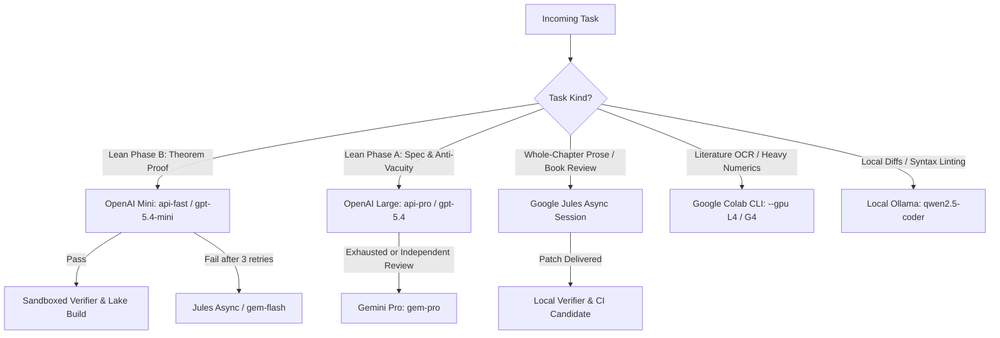

# Resource Telemetry & Empirical ROI Skill

This skill governs multi-agent resource monitoring, empirical yield auditing, cost-per-proof optimization, and budget admission controls across the `/home/lucas/Projects` workspace.

---

## 1. Quick Telemetry & Audit Commands

Any agent or operator can inspect, update, or audit compute resources using these standard CLI entrypoints:

```bash
# 1. Real-time ANSI telemetry dashboard
proj-compute
# or: python3 /home/lucas/Projects/scripts/compute_tracker.py

# 2. Raw JSON telemetry data
python3 /home/lucas/Projects/scripts/compute_tracker.py --json

# 3. Dispatch native distraction-free push summary to iOS via ntfy.sh
proj-compute-notify
# or: python3 /home/lucas/Projects/scripts/compute_tracker.py --notify

# 4. Compile empirical yield & ROI report (YIELD_REPORT.md)
make yield-report
# or: python3 /home/lucas/Projects/scripts/generate_yield_report.py

# 5. Check daily token pool reconciliation and 80%/90% safety flags
make api-ledger
# or: python3 -m agentctl ledger [--day YYYY-MM-DD] [--notify]

# 6. Run pre-flight checks (secrets, admission headroom, git hygiene)
make preflight
# or: python3 /home/lucas/Projects/scripts/preflight_check.py
```

---

## 2. Theoretical Resource Ceilings & Safety Caps

The workspace enforces a **strict 90% admission safety margin** across external model pools and workers to prevent unexpected provider cutoffs or billing spills:

| Resource Backend | Model / Tier | Daily Provider Limit | Local Safety Cap (90%) | Primary Scope & Optimal Allocation | Estimated Daily Yield |
| :--- | :--- | :--- | :--- | :--- | :--- |
| **OpenAI Mini Pool** | `gpt-5.4-mini`<br>(complimentary data sharing) | 2,500,000 tokens / day ($0 cost) | 2,250,000 tokens / day | • Lean Phase B theorem proving<br>• Mechanical compiler repairs<br>• Syntax/lemma fixes | • ~90 theorem proof attempts<br>• ~65–70 proved theorems (at 75% pass rate)<br>• OR ~225–450 syntax repairs |
| **OpenAI Large Pool** | `gpt-5.4`<br>(complimentary data sharing) | 250,000 tokens / day ($0 cost) | 225,000 tokens / day | • Lean Phase A interface specs<br>• Non-vacuity witness design<br>• Reviewer adjudication | • 10–12 deep formal specifications or adjudications |
| **Google Jules** | Async GitHub Worker | 100 sessions / day (15 concurrent) | 90 sessions / day | • Chapter prose rewrites<br>• Book editorial reviews<br>• Asynchronous repository chores | • 15–20 complete chapter rewrites<br>• OR ~3 full book reviews<br>• OR ~90 focused repo refactors |
| **Google Colab CLI** | `colab-cli`<br>(NVIDIA L4 / G4 Blackwell) | Pay-per-compute unit / ephemeral | Auto-terminating single jobs | • Heavy numerical diagonalization<br>• Literature OCR / PDF ingestion | Bounded by project compute units (~300 CU balance; zero idle burn) |
| **Gemini Cloud API** | `gemini-3.8-flash`<br>`gemini-3.1-pro-preview`<br>(prepaid credits: ~$300 BRL) | $8.00 / day cap<br>$50.00 / month cap<br>($2.00 / call max) | Enforced by USD ledger in `models.toml` | • Escalation for Phase A (`gem-pro`)<br>• Escalation for Phase B (`gem-flash`)<br>• Cross-provider review independence | • Flash: ~130–160 fallback tasks/day<br>• Pro: ~25–30 reasoning tasks/day |
| **Google Antigravity** | Interactive Assistant & IDE | 5-hour rolling prompt window | Generation disabled (`execution.toml`) | • Interactive human pairing<br>• Strategic planning & architecture<br>• Diff inspection & manual verification | • 50–80 high-level supervisor turns<br>• Zero bulk code generation |
| **Local Ollama** | `qwen2.5-coder`<br>`qwen3.5` | Unlimited (Local CPU/GPU) | Local machine only | • Offline draft diffs<br>• Format & linting suggestions | Zero marginal cost, zero quota consumption |

---

## 3. Adaptive Resource Routing Matrix

> **Core Principle:** *"Prioritize zero-cost pools first, provided the model has sufficient reasoning capability for the task complexity."*



1. **Mechanical & Standard Theorem Proving (Phase B):**
   * **Route:** `api-fast` (`gpt-5.4-mini`) $\to$ `jules` $\to$ `gem-flash` $\to$ `api-pro`.
   * Fast, low-cost complimentary tokens handle standard lemmas and tactic scripts. Up to 3 bounded compiler-feedback retries are run before escalating.
2. **Deep Mathematical Statement Design (Phase A) & Non-Vacuity Witnesses:**
   * **Route:** `api-pro` (`gpt-5.4`) $\to$ `gem-pro` (`gemini-3.1-pro-preview`).
   * Never dispatch high-level interface definitions or non-vacuity witness stubs to small models that risk vacuous formulations or hallucinated signatures.
3. **Whole-Chapter Prose Rewriting & Manuscript Publishing:**
   * **Route:** `jules` (native branch/patch dispatch).
   * Jules handles large file contexts and full-chapter prose adjustments asynchronously. All mathematical blocks, theorems, labels, and citations are locked byte-for-byte.
4. **Preservation of the Antigravity 5-Hour Limit:**
   * Automated batch scripts must **never** call Antigravity directly for code generation.
   * `orchestrator/config/execution.toml` enforces `[antigravity] enabled = false`. Antigravity is reserved strictly for operator-level steering, diff reviews, and milestone decisions.

---

## 4. Empirical Yield & ROI Metrics

To measure development velocity and economic efficiency across nonlinear research tasks:

1. **Granular Attempt Telemetry:**
   * Every automated call through `agentctl` records an immutable receipt in `.agentctl/attempts/` and appends a row to `orchestrator/benchmarks/runs.jsonl`.
2. **Key ROI Formulas:**
   * $$\text{Yield}_{\text{theorems}} = \frac{\text{Theorems Proved}}{\text{Total Tokens Charged (M)}}$$
   * $$\text{Cost per Proof} = \frac{\text{Total Cloud Spend (USD)}}{\text{Theorems Proved}}$$
   * $$\text{Yield}_{\text{Jules}} = \frac{\text{Accepted Chapter Artifacts}}{\text{Jules Sessions Completed}}$$
   * $$\text{Verification Pass Rate} = \frac{\text{Verified Candidates}}{\text{Total Attempts}} \times 100\%$$
3. **Benchmark Reports:**
   * Running `make yield-report` regenerates [`orchestrator/benchmarks/YIELD_REPORT.md`](file:///home/lucas/Projects/orchestrator/benchmarks/YIELD_REPORT.md).
   * Running `make bench-report` computes Wilson 95% confidence intervals on model performance in [`orchestrator/benchmarks/REPORT.md`](file:///home/lucas/Projects/orchestrator/benchmarks/REPORT.md).

---

## 5. Ledger Maintenance Subcommands

When managing manual compute allocations or adjusting desktop quota countdowns:

```bash
# Update Colab balance after purchasing or checking compute units
python3 scripts/compute_tracker.py colab-set 300.0

# Start tracking an active Colab GPU session
python3 scripts/compute_tracker.py colab-start --gpu L4 --name "reed_simon_ch13_ocr"

# Stop active session and automatically deduct burned compute units
python3 scripts/compute_tracker.py colab-stop

# Update desktop quota status or countdown
python3 scripts/compute_tracker.py quota-set antigravity --weekly 5 --five-hour 100
python3 scripts/compute_tracker.py quota-set codex --status "Available"
```

---

## 6. Failure & Pivot Protocol

Whenever a resource reaches an admission block, quota exhaustion, or systematic model tactic loop:
1. **Never bypass admission gates** (`LLM_SANDBOX=off` or disabling budget caps is strictly forbidden).
2. Record the obstruction in the project's `LOG_DISCOVERY_AND_PIVOTS.md` following the strict 5-column schema:
   `| Date | Module/Context | Obstruction | Pivot/Resolution | Status |`
3. Escalate along the approved decision matrix or defer until pool reset (00:00 UTC for OpenAI/Gemini; Thursday/Friday for desktop quotas).
