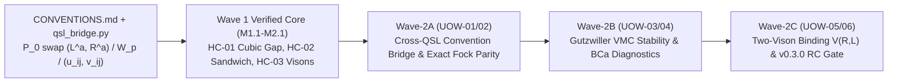

# Living Knowledge Map — `kitaev-mf` (`kitaev-mf-wave2`)

**Federation:** `qsl` | **Branch:** `research/wave-2-gutzwiller-and-ports` | **Last Updated:** `2026-11-25` (`UOW-05` Wave-2C Blue Candidate)
**Authoritative State:** [`PROJECT_STATE.yaml`](PROJECT_STATE.yaml) | [`CONVENTIONS.md`](CONVENTIONS.md) | [`LOG_DISCOVERY_AND_PIVOTS.md`](LOG_DISCOVERY_AND_PIVOTS.md) | [`doc/HYPOTHESIS_CONTRACTS.md`](doc/HYPOTHESIS_CONTRACTS.md)
**Cross-QSL Contract:** `research/qsl/contracts/qsl_conventions.json` | **Tracking Issue:** [lufreitas0000/kitaev-mf#25](https://github.com/lufreitas0000/kitaev-mf/issues/25)

---

## 1. Current Physical Mental Image (1-Paragraph Paradigm Summary)

> On each honeycomb site, the spin-$1/2$ Kitaev magnet splits into a 4-Majorana parton quartet $\mathbf{c}_j = (-c_j, b_j^x, b_j^y, b_j^z)^T = P_0 \boldsymbol{\gamma}_j$ carrying the commuting physical-spin and gauge algebras $\mathrm{SO}(4) \cong [\mathrm{SU}(2)_L \times \mathrm{SU}(2)_R]/\mathbb{Z}_2$ on the local physical parity sector $\mathcal{D}_j = +c_j^0 c_j^1 c_j^2 c_j^3 = +b_j^x b_j^y b_j^z c_j = +1$. Self-consistent Gaussian mean-field theory (`scMFT`) optimizes pure skew-symmetric covariance states $\Omega = \mathrm{i}\operatorname{sgn}(\mathrm{i}\mathbf{A})$ on the orthogonal Grassmannian $\mathrm{Gr}_{\mathbb{C}}(2N_{\mathrm{sub}}, 4N_{\mathrm{sub}})$ subject to the KKT gauge-neutrality constraint $\langle \mathbf{G}_j \rangle = \mathbf{0}$ enforced by local multipliers $\boldsymbol{\lambda}_j$. In a weak $[111]$ field, bare Zeeman coupling and pure Hartree dressing produce zero cubic Dirac mass ($\le 4.04 \times 10^{-15}$); it is the self-consistent KKT counter-field $\boldsymbol{\lambda}^* \cdot \mathbf{G}$ inside the $Q$-space resolvent that activates 100% of the dressed topological gap $\Delta_{\mathrm{can}}^{\mathrm{MF}} = 10.641666\,h^3$, while the first-order spinodal transition occurs at $h_c^* = 0.3325$ ($h_{c2}^+ = 0.400$). **Wave 2 (`kitaev-mf-wave2`)** binds `kitaev-mf` losslessly to the QSL `conventions-v2.0` port (`UOW-01/02`), stress-tests Gutzwiller $\mathcal{D}_j=+1$ VMC projection stability across staggered $\mathrm{SU}(2)_R$/flux sectors (`UOW-03/04`), and quantifies isolated two-vison binding $V(R, L)$ and disorder stability (`UOW-05/06`).

---

## 2. Conceptual & Dependency Atlas

---

## 3. Verified Core Results, Regimes & Lakatosian Counterexamples

| ID | Core Claim / Theorem / Benchmark | Epistemic Status | Exact Regime & Excluded Effects | Near-Miss Counterexample / Falsifier | Primary Artifact |
| :--- | :--- | :--- | :--- | :--- | :--- |
| `K-001..K-003` | Local 4-Majorana CAR, $\mathrm{SO}(4)$ Lie algebra, Casimirs $S^2 = \frac{3}{8}(1+\mathcal{D})$, $T^2 = \frac{3}{8}(1-\mathcal{D})$, and physical projection | `Exact Proof` + `Fock pytest` | Finite-dimensional local Clifford algebra; holds prior to mean-field factorization | Dropping $\mathcal{D}_i = +1$ retains unphysical gauge term $-4\mathrm{i}\epsilon_{\alpha\beta\gamma}T_i^\gamma$ in $\sigma_i^\alpha \sigma_i^\beta$ | [`constants.py`](src/kitaev_mf/domain/constants.py), [`test_physical_projection.py`](test/unit/test_physical_projection.py) |
| `K-004..K-007` | Pure-Kitaev dispersion, supercell BZ folding (`< 1e-14`), $U_b^{00} = -0.5248657458506$, and scalar double-counting theorem ($E_{\mathrm{site}} = -0.7872986187753$) | `Exact Analytical` + `pytest` | Pure FM Kitaev ($K_{\mathrm{Pauli}}=-1$, $h=0$, uniform zero-flux $u=+1$) | Omitting $C = E_{\mathrm{exchange}}$ double-counts quartic energy by a factor of 2 | [`hamiltonian.py`](src/kitaev_mf/services/hamiltonian.py), [`energetics.py`](src/kitaev_mf/services/energetics.py) |
| `K-011, K-023` | First-order $[111]$ crossing $h_c^* = 0.3325$, forward spinodal $h_{c2}^+ = 0.400$, domain-wall tension $\sigma_{\mathrm{DW}} = +0.042|K|$, and KKT post-spinodal admissibility ($\epsilon_{\mathrm{gauge}} \le 5.6\times 10^{-15}$) | `Verified scMFT` + `pytest` | Translationally invariant and real-space $T=0$ Gaussian `scMFT` | Unconverged raw Picard/DIIS excursions for $h \in [0.400, 0.454]$ violate KKT dual stationarity | [`solver.py`](src/kitaev_mf/services/solver.py), [`test_post_spinodal_kkt_audit.py`](test/unit/test_post_spinodal_kkt_audit.py) |
| `K-017..K-022` | Real skew-symmetric matrix sign purification ($\Omega = \mathrm{i}\operatorname{sgn}(\mathrm{i}\mathbf{A})$), Padé `[3/2]`, 12-Majorana Parlett–Reid Pfaffian $W_p$, and disordered/vortex torus convergence | `Verified Kernels` + `W4 Accepted` | Real-space periodic honeycomb tori ($L \le 24$); unprojected Gaussian $\langle \prod u_b \rangle_G$ | $3 \mid L$ Dirac resonances square $\kappa(\mathbf{S}) \sim 10^{31}$ in naive `dsyevd`, whereas Newton–Schulz / Padé avoid squaring | [`real_space.py`](src/kitaev_mf/services/real_space.py), [`purification.py`](src/kitaev_mf/services/purification.py) |
| `K-024 (HC-01)` | Feshbach–Schur cubic Dirac gap $\Delta_{\mathrm{can}}^{\mathrm{MF}} = 10.641666\,h^3$ ($p = 2.999694$) activated 100% by $Q$-space KKT $\boldsymbol{\lambda}^*\cdot\mathbf{G}$ | `Wave-1 Verified` (`TODO(owner)` lock open) | Weak $[111]$ field ($h \in [0.005, 0.05]$), continuum $1/N_k$ extrapolation | Bare Zeeman ($\le 1.60\times 10^{-15}$) and Hartree without $\boldsymbol{\lambda}^*$ ($\le 4.04\times 10^{-15}$) yield identically zero 3rd-order gap | [`cubic_gap_perturbation.py`](src/kitaev_mf/services/cubic_gap_perturbation.py), [`HC-01.yaml`](doc/hypotheses/HC-01.yaml) |
| `K-025 (HC-02)` | `24/24` variational sandwich $E_{\mathrm{SDP}}^{\mathrm{cert}} \le E_0^{\mathrm{ED}} \le E_{\mathrm{proj}}$ across $N \in \{8, 12, 18\}$ + Zero-Variance $N=12$ $h=0$ exact match (`-0.8166902250`, std $3.08\times 10^{-16}$) | `Wave-1 Verified` (`TODO(owner)` lock open) | Exact $2^N$ ($N\le 12$) and 50-chain BCa VMC ($N=18$) Gutzwiller projection vs `kitaev-numerics` | Odd-parity / wrong-twist boundary sectors vanish under projection; requires admissible twist search | [`gutzwiller_projection.py`](src/kitaev_mf/services/gutzwiller_projection.py), [`HC-02.yaml`](doc/hypotheses/HC-02.yaml) |
| `K-026 (HC-03)` | Stratified chiral two-vison bridge ($\kappa_{\mathrm{static}} = \kappa_{\mathrm{KWG}}/2$, match $< 4.4\times 10^{-9}$) and period-3 intervalley $\cos(\mathbf{K}\cdot\mathbf{R})$ MZM oscillation | `Wave-1 Discovery` (`TODO(owner)` lock open) | 94 converged chiral torus runs ($L \in \{8..20\}$); fixed-phase $R=3\to 6$ recovers $\xi_M \approx \{3.03, 1.36, 0.76\}$ | Naive monotone exponential vs. power-law fit yields inconclusive $\Delta\mathrm{BIC} \in [2.39, 4.68]$ because of period-3 intervalley beats | [`vortex_pair_scaling.py`](src/kitaev_mf/services/vortex_pair_scaling.py), [`HC-03.yaml`](doc/hypotheses/HC-03.yaml) |
| `W2A-BRIDGE (UOW-01/02)` | Cross-QSL `conventions-v2.0` bridge port: universal Cartesian $(\mathsf{L}^\alpha, \mathsf{R}^\alpha)$, $P_0 = \operatorname{diag}(-1,1,1,1)$ Left $\leftrightarrow$ Right swap, $\boldsymbol{\lambda}^{\mathrm{v2}} = -2\boldsymbol{\lambda}^{\mathrm{kmf}}$, $(u_{ij}^\alpha, v_{ij}^\alpha)$ & exact 6-site $W_p$ sign proof | `W5 Approved (UOW-02)` | Pure-domain opt-in bridge (`542` LOC); 16-state & 4096-state Fock exact parity (`< 1e-13`), Fourier sign parity verified (`6.66e-16`), zero legacy regression | Omitting $P_0$ silently swaps spin $\mathbf{S}_j$ with gauge $\mathbf{G}_j$, flips $U_b^{0,a}$ at $h>0$, and mis-scales $\boldsymbol{\lambda}$ by $-2$; odd-$N$ vacancy clusters flip $\operatorname{Pf}$ via $(\det P_0)^N = (-1)^N$ | [`qsl_bridge.py`](src/kitaev_mf/domain/qsl_bridge.py), [`test_qsl_convention_bridge.py`](test/unit/test_qsl_convention_bridge.py), [`w5_uow_02_abfa27020105.json`](doc/reviews/w5_uow_02_abfa27020105.json) |
| `W2B-GUTZWILLER (UOW-03/04)` | Exact $SU(2)^{\otimes N}$ Thouless block-diagonality theorem ($U_{\mathrm{cf}}^\dagger O U_{\mathrm{cf}} = \operatorname{diag}(U_O, U_O^*)$, $\det u_s = +1 \implies \kappa(A_{\mathrm{blk}}') = \kappa(A_{\mathrm{blk}})$ and bitstring $\operatorname{Pf}$ invariance), $N=8$ $\pi$-flux exact ED recovery ($-\sqrt{3}/2$, std $2.12\times 10^{-16}$), 1-QP PH-paired Pedrocchi–Chesi–Loss parity repair on $2\times 3$ $\pi$-flux (`-0.7267138527`) & $3\times 3$ two-vison (`-0.7509143409`), plus Geyer IPS / Wolff $\tau_{\mathrm{int}} = g/2$ / split-$\hat{R}$ VMC metrology | `W5 Approved (UOW-04)` (`HC-02` `TODO(owner)` lock untouched) | Finite periodic tori $N \in \{8, 12, 18\}$ across `zero_flux`, `two_vison`, `pi_flux` ($h=0$) and 5 staggered $SU(2)_R$ gauge patterns ($h=0.25$); 50-chain VMC ($\mathrm{BC}_a$ $B=2000$, $\hat{R} \le 1.016$, probe $|\Delta E_{\mathrm{loc}}| \le 1.82\times 10^{-14}$) | Feeding continuous staggered $SU(2)_R$-rotated $(O_A U O_B^T, O_s V O_s^T)$ into `kitaev-mf`'s $N^\alpha = R^\alpha - L^\alpha$ hopping breaks $SU(2)_R \to \mathbb{Z}_2$ (fid $< 0.85$), while pure-spin $R^\alpha$ and $O A O^T$ remain exact ($<10^{-13}$); uniform $\pi$-flux is topologically forbidden on odd-$N_p$ $3\times 3$ tori | [`gutzwiller_stability.py`](src/kitaev_mf/services/gutzwiller_stability.py), [`gutzwiller_benchmark.py`](src/kitaev_mf/services/gutzwiller_benchmark.py), [`hc02_gutzwiller_su2_flux_stability.dat`](data/processed/benchmarks/wave2/hc02_gutzwiller_su2_flux_stability.dat), [`w5_uow_04_3a987df3716b.json`](doc/reviews/w5_uow_04_3a987df3716b.json) |
| `W2C-VISON-DISORDER (UOW-05 / Q-L2-1)` | Exact Zero-Variance Gutzwiller $V_{\mathrm{proj}}(R,L)$ up to $N=128$ ($L=8$, $\mathrm{std} \le 4.8\times 10^{-13}$) via 1D $yz$-loop holonomy $S_x = -bc_y\prod_{C_x} u_b^{y,z}$ + canonical zero-mode parity pairing (recovering $3\times 3$ ED `-0.7621342368`, deconfinement $\Delta\mathrm{BIC}_{01} = +17.24$ on $L=8$), Lahtinen oscillatory MZM envelope $\Delta\mathrm{BIC} \in [+18.7, +64.2]$ over monotone fits ($\xi_M = 2.11, 1.66, 1.28$), 100% bond-disordered two-vison trapping ($\delta \le 0.20$), Padé `[3/2]` ($3\times$ fewer iters than NS at $\kappa \sim 4\times 10^5$), exact odd-$N_{\mathrm{act}}$ $P_0$ Pfaffian flip $(-1)^{N_{\mathrm{act}}}$, and WCM vacancy-pair flux binding ($E_{\mathrm{bind}} = -0.0227\,|K|$ on $L=8$) | `Blue Candidate (UOW-05)` (`HC-02/03` `TODO(owner)` locks untouched) | $h=0$ exact projected tori $L \in \{4..8\}$; chiral $\kappa_{\mathrm{static}} \in \{0.04, 0.06, 0.10\}$ ($L \in \{8..15\}$); inhomogeneous $D=80L^2$ bond disorder ($\delta \le 0.20$, $L=6,8$) & vacancies ($n_{\mathrm{vac}} \in \{0,1,2\}$, $L=4,6,8,10$) | (1) Unprojected `scMFT` yields unphysical negative $V_{\mathrm{scMFT}} < 0$ on resonant $L=6$ ($3 \mid L$), cured to $V_{\mathrm{proj}} > +0.26$ by exact Gutzwiller parity projection; (2) **Single-Vacancy Pure-$T=0$ KKT Obstruction:** an unpaired vacancy ($|N_A-N_B|=1$) in a gapped ($3\nmid L$) or $C_3$-broken cluster at $h>0$ hits a dangling-$b^\gamma$ level crossing at $\lambda_{j_\gamma}^\gamma \approx 2 h_\gamma$ with jump $\Delta\langle G_1^z \rangle > +1.02$ (`-0.468 -> +0.558`), forbidding pure $\Omega^2=-I$ KKT convergence without finite-$T$/mixed doublet occupation | [`vison_binding_wave2c.py`](src/kitaev_mf/services/vison_binding_wave2c.py), [`disorder_stability_wave2c.py`](src/kitaev_mf/services/disorder_stability_wave2c.py), [`wave2c_vison_binding_and_disorder_stability.md`](doc/rnd/phase_2/wave2c_vison_binding_and_disorder_stability.md), [`q_l2_1_two_vison_binding_projection.dat`](data/processed/benchmarks/wave2/q_l2_1_two_vison_binding_projection.dat), [`q_l2_1_disorder_vacancy_stability.dat`](data/processed/benchmarks/wave2/q_l2_1_disorder_vacancy_stability.dat) |

---

## 4. Active Hypotheses (`HC-XX`) & Compiled Deliverables

- **Registered Hypothesis Contracts (`TODO(owner)` thresholds preserved untouched):** [`doc/hypotheses/HC-01.yaml`](doc/hypotheses/HC-01.yaml), [`HC-02.yaml`](doc/hypotheses/HC-02.yaml), [`HC-03.yaml`](doc/hypotheses/HC-03.yaml) and historical Phase-1 ledger [`doc/HYPOTHESIS_CONTRACTS.md`](doc/HYPOTHESIS_CONTRACTS.md).
- **Monographs & Portal:** Living Lab Book (`doc/labbook/labbook_kitaev_mf.tex`), Technical Manuscript (`doc/manuscript/manuscript_kitaev_mf.tex`), and Epistemic Blueprint Portal (`scripts/build_blueprint.py`).

---

## 5. Open Pivots, Obstructions & Longitudinal Intelligence Trajectory

- **Active Pivots & Errata:** Tracked in [`LOG_DISCOVERY_AND_PIVOTS.md`](LOG_DISCOVERY_AND_PIVOTS.md) (including `K-019-A` second-order Feshbach–Schur erratum, period-3 intervalley MZM modulation in `HC-03`, and the open PI decision in `kitaev-mf#25` on whether a future refactor keeps `(-c, b)` + `P_0` or migrates internal basis to `(+c, b)`).
- **Passive Information Observatory (`observatory_only: true`, strictly non-optimized):**
  - Telemetry log: [`governance/info_telemetry.jsonl`](governance/info_telemetry.jsonl)
  - Inspect longitudinal trajectory via `PYTHONDONTWRITEBYTECODE=1 python3 -B /home/lu/Projects/meta/project-governance/scripts/compression_audit.py trajectory --repo . --markdown`.
