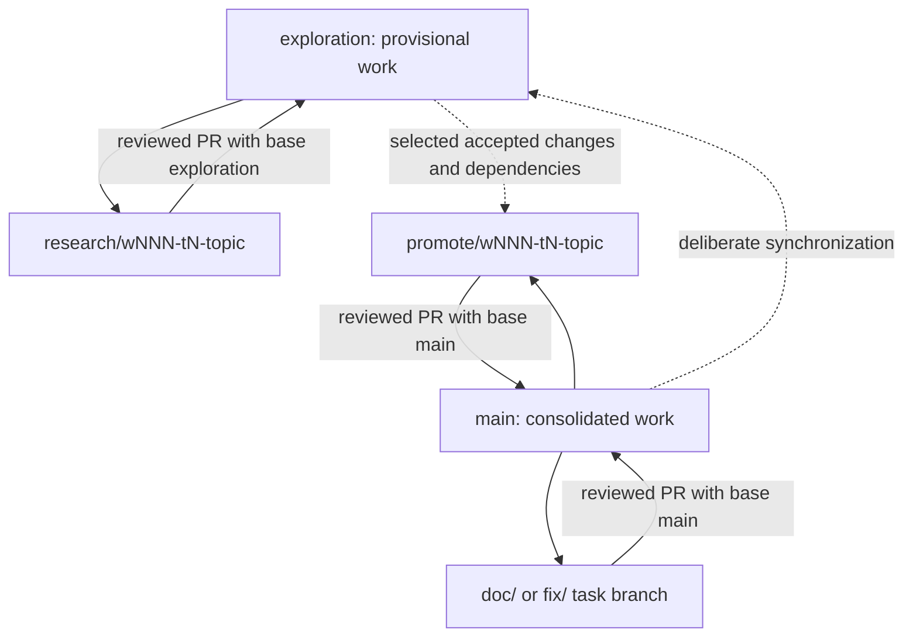

# How work moves through Git in kitaev-mf

The two shelves are **exploration**, where research is collected, and **main**,
where individually accepted contributions are assembled. Temporary branches are
workbenches for a single task. Rules 01 and 10 define the detailed procedure.

For example, an experiment testing thermal covariance starts from exploration.
Its PR goes back to exploration even if the experiment fails scientifically.
When a particular identity or implementation has sufficient evidence, a separate
promotion starts from main, contains only that accepted contribution and its
dependencies, and requests a PR into main. Unrelated experiments stay on exploration.

A correction to the accepted book starts from main and returns there by PR.
A provisional wave note starts from exploration and returns to exploration.
Neither branch gets its own competing official labbook. Builds are previews or
versioned publication artifacts as defined in Rules 09/10.

**Commit** records a local checkpoint. **Push** copies the branch to GitHub.
**PR** requests review and integration into a named target. **Merge** joins the
accepted changes into that target. **Release** publishes selected versioned
outputs. These are separate events, with separate evidence and authorization.

Archive tags preserve old inputs without creating more active development
branches. The Phase 3 untracked snapshot is unreviewed preservation, not a claim
that the code works. Worktree files remain untouched until explicit integration.

## Current transition

W001 T3 preserved the former local main under `archive/w001-local-main` and its
archive tag, then aligned local main with the existing remote baseline. No reset
or discard was used. The seven inherited local commits are collected with all
research sources in `research/w001-t3-source-integration`, intended for exploration.

The exploration branch exists at the remote-main baseline. Its integration PR
remains draft because one original braiding test fails on the untouched source;
the PI chose foundation review before that merge. Thus there is one active
combined candidate, not parallel phase development. Original worktrees are
preservation inputs and have not been cleaned or deleted.

Candidate workflow filters cover the new branch/PR destinations, with publication
separate from ordinary checks. Remote main retains its old workflows until a
separately reviewed promotion. No server protection settings were changed.
