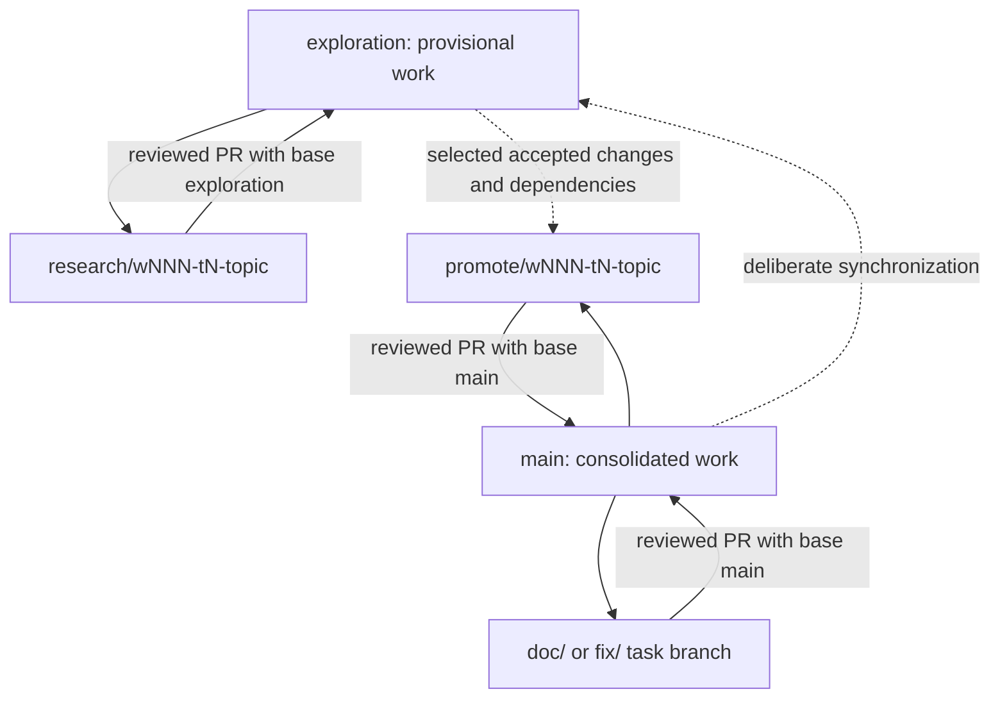

# How work moves through Git in kitaev-mf

The two shelves are **exploration**, where research is collected, and **main**,
where individually accepted contributions are assembled. Temporary branches are
workbenches for a single task. Rules 01 and 10 define the detailed procedure.

For example, an experiment testing thermal covariance starts from exploration.
Its PR goes back to exploration even if the experiment fails scientifically.
When a particular identity or implementation has sufficient evidence, a separate
promotion starts from main, contains only that accepted contribution and its
dependencies, and requests a PR into main. Unrelated experiments stay on exploration.

A correction to the accepted book starts from main and returns there by PR.
A provisional wave note starts from exploration and returns to exploration.
Neither branch gets its own competing official labbook. Builds are previews or
versioned publication artifacts as defined in Rules 09/10.

**Commit** records a local checkpoint. **Push** copies the branch to GitHub.
**PR** requests review and integration into a named target. **Merge** joins the
accepted changes into that target. **Release** publishes selected versioned
outputs. These are separate events, with separate evidence and authorization.

Archive tags preserve old inputs without creating more active development
branches. The Phase 3 untracked snapshot is unreviewed preservation, not a claim
that the code works. Worktree files remain untouched until explicit integration.

## Current transition

Local main and remote main are not identical. W001 T1/T2 are stacked documentation
work from the recorded local-main baseline. Their pushes are review backups;
main-targeted PRs must not silently carry the seven inherited commits. T3 will
reconcile this baseline, create exploration, and update workflow filters before
routine research PRs use the new destinations. Server protection settings have
not been changed by this guide.
