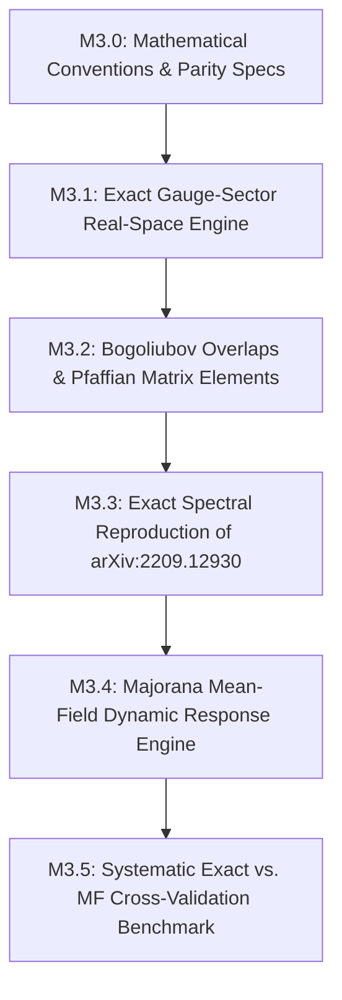

# Strategic Architecture for Phase 3: Dynamical Spin Correlators in FM Kitaev [111]

## 1. Executive Summary & Scientific Scope

This blueprint establishes the operational and theoretical roadmap for **Phase 3** of the `kitaev-mf` program. In accordance with user governance:
1. **Model Scope:** Pure Ferromagnetic Kitaev ($K = -1.0$) under magnetic field $\mathbf{h} \parallel [111]$ with 3-spin chirality interaction $\kappa = \frac{h_x h_y h_z}{\Delta_{\mathrm{flux}}^2}$.
2. **Computational Platform:** Calculations are performed primarily on **real-space lattices** (honeycomb tori and cylindrical/open clusters), utilizing **reciprocal-space Bloch grids as reality checks and benchmark controls**.
3. **Dual Theoretical Tracks:**
   - **Track A (Exact Reference):** Exact non-equilibrium gauge-quench formulation reproducing arXiv:2209.12930 (*Scanning tunneling spectroscopy of Majorana zero modes in a Kitaev spin liquid*, Phys. Rev. B **107**, 054432).
   - **Track B (Mean-Field Generalization):** Extension to the 4-Majorana mean-field theory of `kitaev-mf`, establishing where the mean-field approximation captures the exact dynamical response and diagnosing vertex/projection corrections.

---

## 2. Theoretical Foundations (The Three Pillars)

### 2.1 Pillar 1: Parity Constraints & Physical Subspace Projection
- **Baskaran–Mandal–Shankar (2007) & Knolle et al. (2014):** In the Majorana representation, $\sigma_j^\gamma = \mathrm{i} b_j^\gamma c_j$. Applying a local spin flip toggles the static $\mathbb{Z}_2$ link variable $\hat{u}_{jk}^\gamma = \mathrm{i} b_j^\gamma b_k^\gamma \to -\hat{u}_{jk}^\gamma$, creating a pair of adjacent $\mathbb{Z}_2$ fluxes (visons) on plaquettes sharing the bond $\langle jk \rangle_\gamma$.
- **Pedrocchi–Chesi–Loss (2011) & Zschocke–Vojta (2015):** The physical projection operator $P = \frac{1}{2}(1 + \mathcal{P})$ ties physical matter fermion parity $P_f = \pm 1$ to the total $\mathbb{Z}_2$ flux sector and boundary conditions. In finite clusters, failing to enforce this parity constraint creates false spectral weight and incorrect matrix selection rules.
- **Physical Ground State:**
  $$E_{G,0}^{\mathrm{phys}} = E_{G,0} + \begin{cases} 0, & \pi_G = +1 \\ \epsilon_{G,1}, & \pi_G = -1 \end{cases}$$

### 2.2 Pillar 2: Dynamical Gauge Quench & Many-Body Overlaps
- Evaluating $S_{jl}^{\alpha\beta}(\omega) = \int \mathrm{d}t\, \mathrm{e}^{\mathrm{i}\omega t} \langle \Phi_0 | \sigma_j^\alpha(t) \sigma_l^\beta(0) | \Phi_0 \rangle$ requires solving a quantum quench between two quadratic Majorana Hamiltonians $H_G$ and $H_{G_j^\alpha}$:
  $$S_{jl}^{\alpha\beta}(\omega) = \sum_{\phi(G_j^\alpha)} \langle \phi_0(G) | c_j | \phi(G_j^\alpha) \rangle \langle \phi(G_j^\alpha) | c_l | \phi_0(G) \rangle \delta(\omega + E_0 - E_\phi) \delta_{\alpha\beta} (\delta_{jl} - \mathrm{i} u_{jl}^\alpha \delta_{\langle jl \rangle_\alpha}).$$
- **Selection Rule:** $S_{jl}^{\alpha\beta}(\omega) = 0$ identically unless $\alpha = \beta$ and either $j = l$ (on-site) or $j, l$ are nearest neighbors on a $\gamma$-bond with $\gamma = \alpha$.
- **Bogoliubov Transformation & Overlaps:**
  $$W = U_{G_j^\alpha}^\dagger U_G = \begin{pmatrix} X^* & Y \\ Y^* & X \end{pmatrix}.$$
  - **Regular Case ($\det W = +1$):** Vacuum overlap $|\langle 0_b | 0_a \rangle|^2 = \sqrt{\det(X^\dagger X)}$.
  - **Singular Case ($\det W = -1$):** Resolved via particle-hole interchange (Eq. 29 of arXiv:2209.12930).

### 2.3 Pillar 3: Scanning Tunneling Spectroscopy (STS) of MZMs
- Inelastic cotunneling mediated by exchange coupling yields differential conductance:
  $$\frac{\mathrm{d}I}{\mathrm{d}V}(V, \mathbf{r}) \propto S_{\mathrm{loc}}^{\gamma\gamma}(\omega = eV, \mathbf{r}).$$
- Three distinct spectral structures:
  1. $\omega \approx 0$: Isolated Majorana zero-mode peak bound to vortex core (decays radially as $\mathrm{e}^{-r/\xi_M}$).
  2. $\omega \approx \Delta E_{2v}$: Local vison pair-creation threshold.
  3. $\omega \ge \Delta E_{2f} = \frac{3\sqrt{3}}{2}|\kappa|$: Two-Majorana itinerant continuum onset.

---

## 3. Phase 3 Milestone Decomposition

### Milestone M3.0: Theoretical Specification & Frozen Contracts
- Fix all signs, normalizations, and conventions for $H_K$, matter Majoranas $c_j$, gauge link operators $u_{jk}$, and 3-spin chirality $\kappa$.
- Derive and freeze the exact physical parity formulas for OBC and torus geometries.
- Define the benchmark API and data structures.

### Milestone M3.1: Real-Space Gauge-Sector Engine & Quench Pairs
- Real-space honeycomb lattice generator with torus (PBC) and cylinder/cluster (OBC) boundary geometries.
- Reference configurations: vortex-free $G_0$ and isolated two-vortex configuration $G$ (well-separated to avoid MZM hybridization).
- Perturbed bond-flipped sector generator $G_j^\alpha$.
- Skew-symmetric BdG solvers extracting positive excitation energies $\epsilon_n \ge 0$ and eigenvectors $U_G, U_{G_j^\alpha}$.
- Physical parity determination $\pi_G \in \{\pm 1\}$.

### Milestone M3.2: Bogoliubov Overlaps & Matrix Elements
- Construct transformation $W = U_{G_j^\alpha}^\dagger U_G$ and extract blocks $X, Y$.
- Verify Bogoliubov canonical identities ($XX^\dagger + YY^\dagger = I$, $X^\dagger X + Y^T Y^* = I$, $XY^T + YX^T = 0$).
- Implement regular Thouless state representation and singular $\det W = -1$ particle-hole interchange.
- Evaluate matter matrix elements $\langle \phi | c_j | \phi_0 \rangle$ and verify against exact Fock-space diagonalizations on small clusters ($N \le 16$).

### Milestone M3.3: Reproduction of arXiv:2209.12930 Spectrograms
- Implement Lehmann spectral summation with excitation cutoff $n_{\max} \in \{0, 1, 2, 3, 4\}$.
- Reproduce published Figure 3: $S_G(\omega)$ for tip on vortex core, nearest ring, and far-field bulk.
- Reproduce published Figure 4: Spatial decay map of zero-bias conductance $\mathrm{d}I/\mathrm{d}V(\mathbf{r}, V=0)$ demonstrating exponential localization $\sim \mathrm{e}^{-r/\xi_M}$.
- Verify exact sum rules $\int_0^\infty S_{jj}^{\alpha\alpha}(\omega) \mathrm{d}\omega = 1$.

### Milestone M3.4: 4-Majorana Mean-Field Dynamical Response
- Formulate dynamical spin response within the `kitaev-mf` 4-Majorana mean-field framework.
- Evaluate connected two-particle bubble convolutions and RPA/TD-HFB linear response.
- Determine whether mean-field spin operators produce transitions across mean-field sectors or within the single self-consistent quasiparticle vacuum.

### Milestone M3.5: Exact vs. Mean-Field Systematic Benchmark
- Quantitative comparison: peak positions, spectral weights, vison gap thresholds, and sum rules between exact quench (M3.3) and mean-field response (M3.4).
- Parameter sweeps across $h/|K| \in [0, 0.40]$ and cluster sizes $L \in \{12, 18, 24, 37\}$.
- Documented analysis of mean-field approximations, gauge projection effects, and screening corrections.

---

## 4. Hypothesis Contracts for Phase 3

| Hypothesis ID | Statement | Falsification Test | Target Outcome |
| :--- | :--- | :--- | :--- |
| **`H_DYN_01`** | Single-link gauge flip locality | Compute flux $W_p$ for all plaquettes under $\sigma_j^\gamma$ | Exactly two adjacent plaquettes flip flux ($W_p \to -W_p$); all other plaquettes unchanged |
| **`H_DYN_02`** | Selection rule vanishing | Compute $S_{jl}^{\alpha\beta}(\omega)$ for forbidden channels ($\alpha \neq \beta$ or non-neighbor $|j-l| > 1$) | $|S_{jl}^{\alpha\beta}(\omega)| < 10^{-14}$ strictly |
| **`H_DYN_03`** | Physical parity spectral selection | Compare projected vs. unprojected Lehmann spectral sums | Unprojected sum contains spurious subgap states eliminated by $P = \frac{1}{2}(1 + \mathcal{P})$ |
| **`H_DYN_04`** | Bogoliubov overlap exactness | Compare overlap $\langle \phi | c_j | \phi_0 \rangle$ with exact ED on small clusters ($N \le 16$) | Relative error $< 10^{-12}$ |
| **`H_DYN_05`** | Singular Thouless resolution | Test particle-hole interchange on sectors with $\det W = -1$ | Unitary normalization preserved; no division by zero or NaN |
| **`H_DYN_06`** | Lehmann cutoff convergence | Compute $S(\omega)$ with $n_{\max} = 1, 2, 3, 4$ | $n_{\max} = 2$ accounts for $> 95\%$ of spectral weight below vison threshold |
| **`H_DYN_07`** | MZM origin of zero-bias peak | Compare two-vortex, vortex-free, and tip positions | Zero-bias peak exists exclusively at vortex core in the chiral phase ($\kappa > 0$) |
| **`H_DYN_08`** | Radial spatial decay | Track peak intensity vs. distance $r$ from core | Monotonic exponential decay $\sim \mathrm{e}^{-r/\xi_M}$ with $\xi_M \approx J/\Delta_{\mathrm{bulk}}$ |
| **`H_DYN_09`** | Equal-time spectral sum rule | Numerically integrate $\int_0^\infty S_{jj}^{\alpha\alpha}(\omega)\mathrm{d}\omega$ | Normalized to $1.000 \pm 0.005$ |
| **`H_DYN_10`** | Mean-field benchmark parity | Compare $S_{\mathrm{MF}}(\omega)$ against $S_{\mathrm{exact}}(\omega)$ at $h \to 0$ | Quantitative documentation of spectral threshold shifts and projection corrections |
